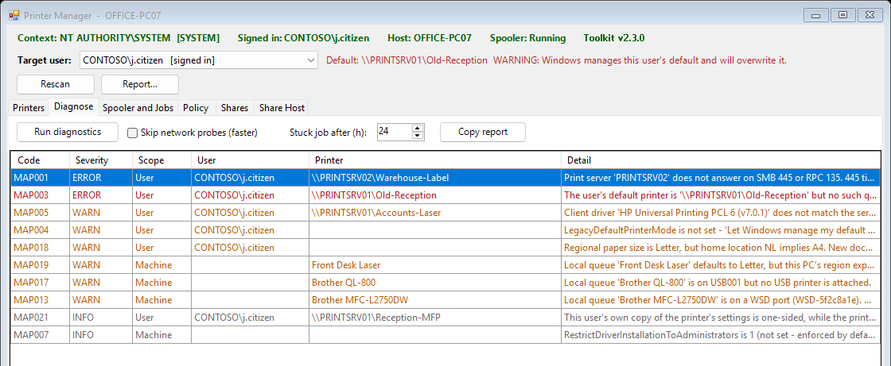

# Printer Manager

A WinForms printer console for **Windows PowerShell 5.1**, built to run as **SYSTEM in a ScreenConnect Backstage session** without disturbing the user. It sees what Backstage normally can't: the signed-in user's own mapped printers. It fixes them in that user's session, so the change actually applies and sticks, and it explains the usual printer error codes instead of leaving you to guess.

From [ihavenoram.com](https://ihavenoram.com): field notes for ADHD techs running managed services.



## Download

Grab **`printers.zip`** from **[Releases](../../releases/latest)**. It holds one folder, `printers\`, with only what runs: the scripts and a `.cmd` launcher for each. Copy that folder to the PC or server (for example `C:\temp\printers`); this README and the docs stay here on GitHub. The SHA-256 checksum is in the release notes and in the `.sha256` file beside the zip:

```powershell
Get-FileHash .\printers.zip -Algorithm SHA256
```

## Run it

Copy the two files to a **local disk** on the PC (keep them together) and double-click **`Launch-PrinterManager.cmd`**.

- **In Backstage** (SYSTEM) or an elevated session it starts straight away.
- **Otherwise** it asks for elevation through UAC. Decline and the console still opens, unelevated, for read-only work. Pass `/noelevate` to skip the prompt.

If the window never appears, run `Launch-PrinterManager.cmd -NoHideConsole` to keep the console visible and see where it stops.

## Why the target-user picker matters

From SYSTEM, every per-user printer change (setting the default, `printui.dll`, `Remove-Printer` on a `\\server\printer` connection) silently lands in **SYSTEM's own profile and reports success**. `Get-Printer` run as SYSTEM can't even see a user's mapped printers. So Printer Manager reads them from the user's registry hive, and makes every per-user change through the **selected user's session**. If nobody is signed in, the banner turns red and per-user actions are refused instead of quietly doing the wrong thing.

## What it does

| Tab | What you get |
|---|---|
| **Printers** | The PC's queues merged with the selected user's mapped printers. Rename, delete, set the default (so Windows doesn't take it back), test reachability, print a test page, open Print Management. |
| **Diagnose** | Coded findings with the likely cause and fix (below). **Copy report** for the ticket. |
| **Spooler and Jobs** | Spooler control, stuck jobs by age, orphaned spool files. |
| **Policy** | Point and Print and the driver-install restrictions, shown as the **effective** value (most default to enforced when unset), plus a Windows error-code decoder. |
| **Shares** / **Share Host** | Connecting to a printer shared from another PC, and the PC doing the sharing, including the print RPC settings behind `0x0000011b`. |

### Diagnostic findings

| Code | Condition | Usually seen as |
|---|---|---|
| MAP001 | Print server not answering on SMB 445 / RPC 135 | `0x00000bcb`, or a hang |
| MAP002 | Server reachable, but the queue isn't in its share list | `0x00000709` |
| MAP003 | The user's default names a printer that doesn't exist | `0x00000709` |
| MAP004 | Windows is set to manage the default printer | the default silently reverts |
| MAP005 | Client driver name differs from the server's | `0x00000bcb` |
| MAP006 | Package Point and Print only, against a non-package-aware driver | `0x00000bcb` |
| MAP007 | Driver installs restricted to administrators, user not an admin | `0x0000011b`, `0x00000709` |
| MAP008 | `RpcAuthnLevelPrivacyEnabled` set to 0 | a security downgrade: **reported, never applied** |
| MAP009 | A mapped printer with no live queue behind it | a phantom printer |
| MAP010 | Old or orphaned spool jobs | silent no-print |
| MAP011 | Printer resolves but 9100 / 515 / 631 are all closed | printer off or asleep |
| MAP012 | SNMP status on, device not answering | queue flips to Offline |
| MAP013 | WSD port on a network queue | intermittent loss |
| MAP014 | Queue offline, paused or in error | jobs never print |
| MAP015 | Spooler stopped, or crashing | nothing prints |
| MAP016 | Queue on the generic IPP class driver | lost trays, duplex and finishing |
| MAP017 | USB queue with no printer attached | silent no-print |
| MAP018–020 | Paper size doesn't match the region (Letter vs A4) for the user, the queue or a connection | the printer asks for the other paper |
| MAP021 | A user's copy of a printer duplexes differently from the default | one user gets two-sided, another doesn't |

## Facts it's built around

Each of these was measured, and each one breaks an approach that looks reasonable:

- `Test-Path '\\server\printer'` returns `False` for a share that works. Print shares aren't filesystem objects, so probes use TCP 445/135 and `\\server\print$`.
- `Test-NetConnection` took 8.4 s where a raw socket took 17 ms, and reported a failed ping while port 9100 was open. Probes use raw sockets and never depend on ICMP.
- `PrinterStatus`, `WorkOffline` and `DetectedErrorState` all reported healthy on a queue holding a seven-month-old stuck job. Health comes from an active probe plus job age.
- `Add-PrinterConnection` and `Remove-PrinterConnection` don't exist, despite being widely cited. `Add-Printer -ConnectionName` and `Remove-Printer` do.

## Notes

- Windows PowerShell 5.1 only, one self-contained script: nothing else needs to be installed or sit beside it.
- Changing queues, drivers, firewall rules and per-computer connections needs admin or SYSTEM. Without it the console is read-only for those, and says so.
- Network probes touch print servers and printers. Tick **Skip network probes** on the Diagnose tab for a quick local-only pass.

## About

Built with AI assistance (Claude) for real MSP printer tickets. It's provided as is, with no warranty. It changes printer settings when you ask it to, so check how your EDR will react to an elevated PowerShell first.

MIT licensed; see [LICENSE](LICENSE).
